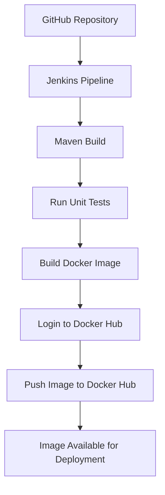

# Spring Boot CI/CD Pipeline with Jenkins and Docker

A hands-on CI/CD project that automates building, testing, containerizing, and publishing a Spring Boot application using **Jenkins, Maven, Docker, and Docker Hub**.

## Architecture



## Technologies Used

| Technology | Purpose |
|---|---|
| Java 25 | Application development |
| Spring Boot 4.1.1 | Application framework |
| Maven 3.10.0 | Build and dependency management |
| Git and GitHub | Source code management |
| Jenkins 2.580.1 | CI/CD pipeline automation |
| Docker Engine | Containerization |
| Docker Hub | Container image registry |
| Fedora Linux 44 | Development environment |

## Project Repository

GitHub: https://github.com/Saralla-Rohit/cicd/

Docker Hub: https://hub.docker.com/u/callmee6

Docker image: `callmee6/devops-integration:latest`

## Project Structure

```text
CICDDemo1/
├── src/
│   ├── main/
│   │   ├── java/
│   │   │   └── com/rohit/
│   │   │       └── CicdDemo1Application.java
│   │   └── resources/
│   └── test/
│       └── java/
├── target/
│   └── devops-integration.jar
├── Dockerfile
├── Jenkinsfile
├── pom.xml
└── README.md
```

*The `target/` directory is generated by Maven and does not need to be committed to Git.*

## 1. Install and Verify Prerequisites

The following tools are required on the Jenkins build agent.

### Java

```bash
java -version
```

### Maven

```bash
mvn -version
```

### Git

```bash
git --version
```

### Docker

```bash
docker --version
docker info
```

Jenkins must be able to execute Docker commands. On a Linux host using the system Docker socket, configure Docker permissions appropriately for the Jenkins service account.

## 2. Build the Application with Maven

Clone the repository:

```bash
git clone https://github.com/Saralla-Rohit/cicd.git
cd cicd
```

Build the project and execute tests:

```bash
mvn clean install
```

This command:

1. Removes the previous build output.
2. Compiles the Java source code.
3. Compiles and executes tests.
4. Packages the Spring Boot application.
5. Installs the generated artifact in the local Maven repository.

Expected artifact:

```text
target/devops-integration.jar
```

To run the application locally:

```bash
java -jar target/devops-integration.jar
```

Stop the application with `Ctrl+C`.

## 3. Create the Docker Image

The Dockerfile packages the generated Spring Boot JAR into a container image.

### Dockerfile

```dockerfile
FROM eclipse-temurin:25-jre

WORKDIR /

ADD target/devops-integration.jar devops-integration.jar

EXPOSE 8080

ENTRYPOINT ["java", "-jar", "/devops-integration.jar"]
```

**Explanation**

- `FROM`: Uses a Java 25 runtime image.
- `WORKDIR`: Sets the working directory inside the container.
- `ADD`: Copies the generated application JAR into the image.
- `EXPOSE`: Documents the application's intended container port.
- `ENTRYPOINT`: Starts the Spring Boot application.

The application's configured server port should match port `8080`.

### Build the image

```bash
docker build -t callmee6/devops-integration:latest .
```

### Verify the image

```bash
docker images
```

### Run the container locally

```bash
docker run --name devops-integration -p 8080:8080 callmee6/devops-integration:latest
```

Access the application at:

http://localhost:8080/

Stop and remove the container when finished:

```bash
docker stop devops-integration
docker rm devops-integration
```

## 4. Configure Jenkins

Open Jenkins:

http://localhost:8080/

### Configure Maven

1. Open **Manage Jenkins → Tools**.
2. Find the Maven installations section.
3. Configure the Maven installation name as `maven3`.
4. Select the appropriate Maven installation or configure automatic installation.

The Jenkins pipeline references this installation by name:

```groovy
tools {
    maven 'maven3'
}
```

### Configure Docker access

Jenkins must be able to run:

```bash
docker build
docker login
docker push
```

On a Linux system where Jenkins uses the host Docker daemon, the Jenkins service account may require membership in the `docker` group.

Example:

```bash
sudo usermod -aG docker jenkins
sudo systemctl restart jenkins
```

**Security note:** Membership in the Docker group grants highly privileged access to the host. Only grant it to trusted accounts.

### Configure Docker Hub credentials

1. Sign in to Docker Hub.
2. Create a personal access token with the required **Read & Write** permissions.
3. In Jenkins, open **Manage Jenkins → Credentials**.
4. Create a credential with the following settings:

| Field | Value |
|---|---|
| Kind | Secret text |
| Secret | Docker Hub personal access token |
| ID | `dockerhub-pwd` |

The pipeline uses this credential ID to retrieve the token securely.

Never commit the token to GitHub or place it directly in the Jenkinsfile.

## 5. Create the Jenkins Pipeline Job

1. Select **New Item** in Jenkins.
2. Enter the job name `cicd-docker`.
3. Select **Pipeline**.
4. Open the Pipeline configuration section.
5. Choose **Pipeline script**.
6. Paste the Jenkinsfile below.
7. Save the job.

## 6. Jenkinsfile

```groovy
pipeline {
    agent any

    tools {
        maven 'maven3'
    }

    stages {
        stage('Build Maven') {
            steps {
                checkout scmGit(
                    branches: [[name: '*/main']],
                    extensions: [],
                    userRemoteConfigs: [[
                        url: 'https://github.com/Saralla-Rohit/cicd/'
                    ]]
                )

                sh 'mvn clean install'
            }
        }

        stage('Build Docker Image') {
            steps {
                sh 'docker build -t callmee6/devops-integration:latest .'
            }
        }

        stage('Push Image to Docker Hub') {
            steps {
                withCredentials([
                    string(
                        credentialsId: 'dockerhub-pwd',
                        variable: 'dockerhubpwd'
                    )
                ]) {
                    sh '''
                        echo "$dockerhubpwd" | docker login \
                            -u callmee6 --password-stdin

                        docker push callmee6/devops-integration:latest
                    '''
                }
            }
        }
    }
}
```

### Pipeline stages explained

**Stage 1 — Build Maven**

- Checks out the `main` branch from GitHub.
- Runs `mvn clean install`.
- Compiles the application, executes tests, and packages the JAR.

**Stage 2 — Build Docker Image**

- Reads the Dockerfile.
- Packages the application into a Docker image.
- Tags the image as `callmee6/devops-integration:latest`.

**Stage 3 — Push Image to Docker Hub**

- Retrieves the access token from Jenkins credentials.
- Authenticates to Docker Hub using `--password-stdin`.
- Pushes the image to the repository owned by `callmee6`.

The image name must be consistent between the build and push commands.

## 7. Execute the CI/CD Pipeline

1. Open the `cicd-docker` job.
2. Click **Build Now**.
3. Open the running build.
4. Select **Console Output**.
5. Verify that all three stages complete successfully.

Expected results include:

```text
BUILD SUCCESS
Login Succeeded
The push refers to repository
[docker.io/callmee6/devops-integration]
Finished: SUCCESS
```

The exact output may vary by build.

## 8. Verify the Published Docker Image

Open the Docker Hub profile:

https://hub.docker.com/u/callmee6

Find the `devops-integration` repository and verify that the `latest` tag is available.

You can also pull the image on a machine with Docker installed:

```bash
docker pull callmee6/devops-integration:latest
```

Run it:

```bash
docker run --rm -p 8080:8080 callmee6/devops-integration:latest
```

Then visit:

http://localhost:8080/

If port `8080` is already in use, choose another host port, for example `8085:8080`.

## 9. Troubleshooting

### Maven build fails

Check the Java and Maven versions:

```bash
java -version
mvn -version
```

Run the build locally:

```bash
mvn clean install
```

### Jenkins cannot access Docker

Test Docker access as the Jenkins service account and inspect the service logs:

```bash
sudo -u jenkins docker info
sudo journalctl -u jenkins -n 100 --no-pager
```

If permission is denied, verify the Docker daemon status and Jenkins user's group membership.

### Docker Hub push fails with `insufficient_scope`

Verify all three items:

- The Docker Hub username is `callmee6`.
- The Jenkins credential `dockerhub-pwd` contains the correct personal access token.
- The token has Read & Write permissions and the repository is accessible to the account.

Ensure the image name is identical in both commands:

```bash
docker build -t callmee6/devops-integration:latest .
docker push callmee6/devops-integration:latest
```

### Docker cannot find the JAR

Build the JAR before building the Docker image:

```bash
mvn clean install
ls -lh target/devops-integration.jar
```

### Application does not open in the browser

Inspect the container:

```bash
docker ps
docker logs <container-name>
```

Confirm that the application listens on port `8080` and that the host port is mapped correctly.

## 10. Current Workflow and Future Improvements

The current pipeline automates:

- Source code checkout from GitHub.
- Maven compilation and packaging.
- Automated test execution.
- Docker image creation.
- Secure Docker Hub authentication through Jenkins credentials.
- Publishing the image to Docker Hub.

Possible next improvements include:

- Triggering the pipeline automatically when code is pushed to GitHub.
- Adding a dedicated code-quality or security-scanning stage.
- Deploying the published image to Minikube or another Kubernetes cluster.
- Adding a deployment stage after the image push.

These are future enhancements and are not included in the current pipeline.

## Key Learnings

- How Jenkins orchestrates a multi-stage CI/CD pipeline.
- How Maven builds and tests a Spring Boot application.
- How a Dockerfile packages a Java application.
- How Docker image tags identify a registry, namespace, repository, and version.
- How Jenkins credentials protect Docker Hub access tokens.
- How to diagnose build failures and image-push permission errors.

---

**Project:** Spring Boot CI/CD with Jenkins and Docker

**GitHub:** https://github.com/Saralla-Rohit/cicd/

**Docker Hub:** https://hub.docker.com/u/callmee6
